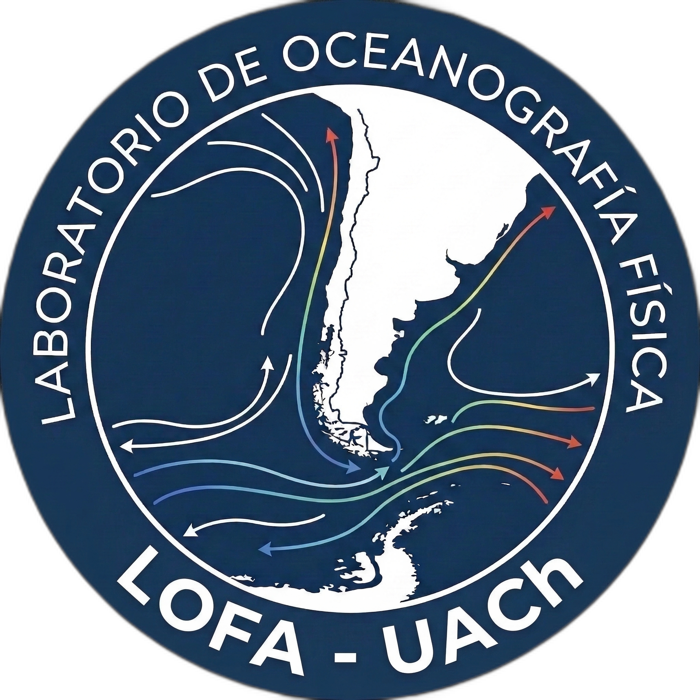

# Dashboard Científico del Anticiclón del Pacífico Sur (APS)
### Laboratorio de Oceanografía Física (LOFA) — Universidad Austral de Chile (UACh)

[](LICENSE)
[](https://laboratorio-oceanografia-fisica-uach.github.io/dashboard-anticiclon-pacifico/)
[](pipeline/)
[](#ciencia-abierta-y-reproducibilidad)

<p align="center">
  
</p>


> [!WARNING]
> ### ⚠️ Estado del Proyecto: Fase Experimental y en Desarrollo Activo
> **Este proyecto y su plataforma web se encuentran actualmente en fase de pruebas, calibración y desarrollo técnico.**  
> Los datos, algoritmos de seguimiento, mapas e indicadores aquí presentados **NO están calificados como referencia definitiva ni 100% fidedigna para la navegación, operaciones marítimas, peritajes, faenas pesqueras ni toma de decisiones críticas o institucionales**. Su propósito en esta etapa es estrictamente experimental, académico y de investigación metodológica interna.

---

##  Acerca del Proyecto

El **Anticiclón del Pacífico Sur (APS)** es el principal modulador de la variabilidad atmosférica y oceanográfica a lo largo de las costas de Chile y Perú, gobernando el régimen de vientos favorables a la surgencia costera, la radiación solar y la dinámica del Sistema de Corrientes de Humboldt.

Este proyecto es una plataforma web científica de **código abierto y acceso público**, desarrollada por el **Laboratorio de Oceanografía Física (LOFA)** del *Instituto de Ciencias Marinas y Limnológicas* de la **Universidad Austral de Chile (UACh)**. 

### Objetivos:
1. **Monitoreo Continuo e Histórico:** Visualizar la posición (latitud, longitud) e intensidad (PSA en hPa) del núcleo del APS sobre el registro observacional (1940 a la fecha).
2. **Comparación Multimodelo y Pronóstico Operativo:** Contrastar de forma interactiva observaciones de reanálisis (ERA5, NCEP/NCAR), ciclos climatológicos de referencia histórica, respuestas compuestas frente al fenómeno ENOS (Fase El Niño y Fase La Niña), y pronósticos numéricos operativos globales a 7 días (NOAA GFS).
3. **Validación Estadística Inter-Modelo (Skill Scores):** Evaluar cuantitativamente la precisión de los modelos frente a las observaciones de referencia mediante métricas estandarizadas en oceanografía física (RMSE, BIAS, Correlación de Pearson $r$, distancia espacial y el índice de Willmott $d$).
4. **Análisis de Anomalías y Bloqueos:** Identificar desplazamientos o intensificaciones anómalas respecto al ciclo anual climatológico medio, detectando patrones de bloqueo atmosférico y condiciones asociadas a olas de calor marinas (*Marine Heatwaves*).
5. **Ciencia Abierta y Reproducible:** Código 100% auditable y datasets consolidados disponibles para descarga directa en formatos estándar abiertos (CSV y JSON).

---

## 📊 Módulos del Dashboard V5.3

- **🗺️ Cartografía Sinóptica e Isobaras Dinámicas (Marching Squares 2D):**  
  Mosaicos cartográficos de alta definición con visualización del **Par Dinámico**: **Núcleo Continuo Submalla (+)** en dorado y **Centroide de Masa (◇)** en cyan eléctrico, unidos por el vector geodésico de desacople. Trazo destacado de la **Isóbara Crítica de 1020 hPa** y polígono delimitador de la **Caja Norpatagonia** ($[-45^\circ\text{S}, -41^\circ\text{S}] \times [-78^\circ\text{W}, -72^\circ\text{W}]$).

- **🌀 Diagrama de Fase Espacial 2D (Longitud vs. Latitud):**  
  Espacio de fase cinemático interactivo (Plotly.js) que mapea la trayectoria del Núcleo y del Centroide clasificando el estado atmosférico en 4 cuadrantes sinópticos: *Retracción Oceánica*, *Cuña Costera (Chile Central)*, *Bloqueo Patagónico Austral* y *Simetría Estival Típica*.

- **📈 Series Temporales Multimodelo (Plotly.js):**  
  5 paneles sincronizados que cubren: 1) Intensidad central $P_{\max}$ y espesor efectivo $\bar{H}$, 2) Cinemática latitudinal y longitudinal del par dinámico, 3) Extensión areal $A_{1020}$ y masa barométrica $I_{\text{vol}}$, 4) Desacople geodésico $D_{nc}$ y presión media en Norpatagonia.

- **🎛️ Selector Multimodelo (Drawer Lateral):**  
  Superposición de productos observacionales y de pronóstico:
  1. *ERA5 Reanálisis (ECMWF)*: Verdad observacional con asimilación 4D-Var de scatterómetros y altimetría satelital.
  2. *Climatología Normal OMM (1994–2023)*: Línea base estándar de 30 años de la era satelital moderna.
  3. *NOAA GFS (Pronóstico Operativo +7 Días)*: Modelo numérico sinóptico global de ecuaciones primitivas (NCEP/NOAA, ciclo 00Z).

- **🧪 Suite de Validación y Física (`tests/test_aps_physics.py`):**  
  Pruebas automatizadas de curvatura negativa en el Hessiano ($\det(H) > 10^{-4}$), continuidad del centroide adaptativo en el colapso estacional de mayo ($P_{\max} < 1020\text{ hPa}$), y cero penetración de centros en tierra continental mediante Natural Earth 10m.

- **📥 Descarga de Datos Científicos:**  
  Exportación directa de la serie temporal consolidada multimodelo en CSV (`aps_multimodel_metrics_lofa.csv`) y JSON estructurado (`latest_aps_data.json`).

---

## 🛠️ Arquitectura Técnica

El proyecto opera bajo una arquitectura desacoplada basada en estándares web abiertos y procesamiento científico automatizado:

1. **Pipeline de Datos (`pipeline/`):**
   - Scripts en Python con librerías científicas (`xarray`, `netCDF4`, `numpy`, `scipy`, `pandas`, `shapely`, `pyshp`).
   - `spatial_geometry.py`: Máscara continental Natural Earth 10m vía Shapely 2.0+ `contains_xy`, elemento diferencial de área esférico $dA(\phi)$, y convolución normalizada marina (supresión del efecto muro).
   - `calculate_aps_metrics.py`: Ajuste cuadrático 2D submalla (`fit_quadratic_2d`), centroide adaptativo, métricas de masa ($A_{1020}, I_{\text{vol}}, \bar{H}$), desacople geodésico ($D_{nc}, \theta$), caja Norpatagonia y climatología OMM 1994–2023.
   - `download_era5.py`: Descarga automatizada de campos horarios de MSLP desde Copernicus CDS.
   - `download_ncep_reanalysis.py`: Descarga y procesamiento del reanálisis histórico NCEP/NCAR (producto independiente, aún no integrado al dashboard).
   - `download_gfs_forecast.py`: Extracción directa de pronósticos operativos a 7 días vía NOAA NOMADS.
   - `paths.py` y `file_utils.py`: Resolución de rutas desde la raíz del proyecto y escritura segura de archivos.
2. **Frontend (`web/`):**
   - Interfaz web reactiva en HTML5 semántico, CSS3 modular (tema *Deep Abyss*) y JavaScript Vanilla con Leaflet.js y Plotly.js, libre al 100% de dependencias de frameworks y de residuos del índice de Bakun.

---

## 📁 Estructura del Repositorio

```text
dashboard-anticiclon-pacifico/
├── .github/workflows/              # Automatización y despliegue continuo
├── data/
│   ├── raw/                        # Datos brutos NetCDF / GRIB (ignorados por Git)
│   │   ├── mean_sea_level_pressure/ # NetCDF anuales de ERA5
│   │   └── ncep_reanalysis/        # NetCDF anuales de NCEP/NCAR
│   ├── temp/                       # Archivos temporales de descargas y GFS
│   ├── processed/                  # Métricas consolidadas en JSON y CSV
│   └── shapefiles/                 # Máscara continental Natural Earth 10m
├── pipeline/                       # Pipeline científico en Python
│   ├── paths.py                    # Resolución de rutas desde la raíz del proyecto
│   ├── file_utils.py               # Validación y escritura segura de archivos
│   ├── spatial_geometry.py         # Geometría esférica, Natural Earth 10m y convolución
│   ├── calculate_aps_metrics.py    # Submalla 2D, Par Dinámico, masa y desacople
│   ├── download_era5.py            # Descarga de reanálisis ERA5 Copernicus
│   ├── download_ncep_reanalysis.py # Descarga y procesamiento de NCEP/NCAR
│   ├── download_gfs_forecast.py    # Descarga operativa de pronóstico NOAA GFS
│   └── requirements.txt            # Dependencias científicas
├── tests/                          # Suite de pruebas unitarias geofísicas
│   └── test_aps_physics.py         # Pruebas de submalla, mayo, costas y desacople
├── web/                            # Visualizador web interactivo
│   ├── index.html                  # Estructura principal, KPIs y modales KaTeX
│   ├── styles/                     # Sistema de diseño CSS moderno
│   ├── js/                         # Orquestador (main), mapas (maps) y gráficos (charts)
│   ├── data/                       # Archivos JSON y CSV para el navegador y descarga
│   └── assets/                     # Recursos gráficos y logo institucional LOFA
├── docs/                           # Documentación oceanográfica y metodológica
│   └── METODOLOGIA.md              # Ecuaciones físicas del Par Dinámico y Masa V5.3
├── CITATION.cff                    # Metadatos estandarizados para citar este software
├── LICENSE                         # Licencia libre GNU AGPLv3
└── README.md
```

---

## 🌐 Acceso Directo a la Plataforma Web

Cualquier usuario, investigador o tomador de decisiones puede consultar el dashboard directamente desde su navegador web **sin necesidad de instalar software, clonar repositorios ni configurar entornos**:

👉 **[Acceder al Observatorio del APS en Vivo](https://laboratorio-oceanografia-fisica-uach.github.io/dashboard-APS/)** 

---

## 💻 Reproducibilidad y Código Fuente

Para investigadores que deseen auditar las rutinas numéricas, verificar la reproducibilidad de los cálculos o procesar sus propios campos de reanálisis, las instrucciones de ejecución técnica están disponibles a continuación:

<details>
<summary><b>🛠️ Desplegar para ver instrucciones de ejecución local del pipeline (Python)</b></summary>

### 1. Clonar el repositorio
```bash
git clone https://github.com/Laboratorio-Oceanografia-Fisica-UACh/dashboard-anticiclon-pacifico.git
cd dashboard-anticiclon-pacifico
```

### 2. Requisitos del sistema

- **Python 3.11 o superior** (recomendado).
- **Credenciales de Copernicus CDS** para descargar ERA5.
- **`cfgrib` y `eccodes`** para procesar el pronóstico GFS en GRIB2. Se instalan con `pipeline/requirements.txt`.
- Espacio en disco suficiente para los NetCDF anuales de ERA5 y NCEP.

> [!TIP]
> En algunos sistemas, `eccodes` puede requerir librerías adicionales del sistema. Si la instalación falla, revisa la documentación de `eccodes` o instálalo desde `conda-forge`.

### 3. Configurar el entorno de Python

> [!TIP]
> Si utilizas **Fish Shell** (muy común en Arch Linux), debes activar con `source venv/bin/activate.fish`. O bien, puedes invocar los binarios directamente sin activar el entorno.

**Opción A: Invocación directa (Universal para Bash, Zsh y Fish — recomendada en Arch Linux):**
```bash
python3 -m venv venv
./venv/bin/pip install -r pipeline/requirements.txt
```

**Opción B: Activando el entorno según tu shell:**
- **Bash / Zsh:**
  ```bash
  python3 -m venv venv
  source venv/bin/activate
  pip install -r pipeline/requirements.txt
  ```
- **Fish Shell:**
  ```fish
  python3 -m venv venv
  source venv/bin/activate.fish
  pip install -r pipeline/requirements.txt
  ```
- **Windows (PowerShell):**
  ```powershell
  py -3 -m venv venv
  .\venv\Scripts\python -m pip install -r pipeline\requirements.txt
  ```

### 4. Configurar credenciales de Copernicus CDS

1. Crea una cuenta en el [Climate Data Store](https://cds.climate.copernicus.eu/).
2. Acepta la licencia del dataset **ERA5 single levels**.
3. Copia el bloque de credenciales que aparece en tu perfil de CDS.
4. Guárdalo en:
   - Linux/macOS: `~/.cdsapirc`
   - Windows: `%USERPROFILE%\.cdsapirc`

El archivo debe tener este formato, usando los valores exactos que entrega Copernicus:

```text
url: <URL indicada por Copernicus>
key: <TU-API-KEY>
```

> [!WARNING]
> No versiones `~/.cdsapirc` ni claves reales en el repositorio.

### 5. Estructura de `data/`

El repositorio versiona la estructura mínima mediante archivos `.gitkeep`, pero **no incluye datos crudos pesados**:

- `data/raw/mean_sea_level_pressure/`: NetCDF anuales de ERA5.
- `data/raw/ncep_reanalysis/`: NetCDF anuales de NCEP/NCAR.
- `data/temp/`: descargas temporales y archivos GFS.
- `data/processed/`: métricas consolidadas en JSON y CSV.
- `data/shapefiles/`: máscara continental Natural Earth 10m.

Los scripts resuelven las rutas relativas contra la raíz del proyecto. Se pueden ejecutar desde cualquier directorio; las rutas absolutas se respetan tal cual.

### 6. Orden recomendado de ejecución

```bash
# 1. Descargar ERA5 (requiere credenciales CDS)
./venv/bin/python pipeline/download_era5.py --years 2024

# 2. Opcional: descargar y procesar NCEP/NCAR (ejemplo para años específicos)
./venv/bin/python pipeline/download_ncep_reanalysis.py --years 2022 2023

# O si ya cuentas con NetCDFs descargados localmente:
# ./venv/bin/python pipeline/download_ncep_reanalysis.py --process-only

# 3. Opcional: descargar el pronóstico GFS de 7 días
./venv/bin/python pipeline/download_gfs_forecast.py

# 4. Calcular métricas y actualizar el dashboard
./venv/bin/python pipeline/calculate_aps_metrics.py
```

En Windows, reemplaza `./venv/bin/python` por `.\venv\Scripts\python`.

### 7. Ver el dashboard o recalcular métricas

- **Solo ver el dashboard:** un clon limpio ya incluye los archivos procesados en `web/data/`. Basta con servir `web/`.
- **Recalcular métricas:** necesitas los NetCDF crudos en `data/raw/mean_sea_level_pressure/`. El pipeline falla con un mensaje explícito si no encuentra datos.
- **NCEP/NCAR:** actualmente es un producto independiente y no está integrado al dashboard ni al JSON principal.
- **GFS:** requiere `cfgrib` y `eccodes`; si faltan, el script lo informa antes de consultar NOAA.

### 8. Servidor de prueba local
Para visualizar la interfaz web de inmediato:
```bash
python3 -m http.server 8000 --directory web
```
Abre en tu navegador: `http://localhost:8000`

### 9. Ejecutar las pruebas
```bash
./venv/bin/python -m unittest discover -s tests -v
```

</details>

---

**Atribución Institucional:**  
Laboratorio de Oceanografía Física (LOFA)  
Instituto de Ciencias Marinas y Limnológicas (ICML)  
Facultad de Ciencias — Universidad Austral de Chile  
Valdivia, Chile.

---

## Declaración de Transparencia: Uso de Asistencia por Inteligencia Artificial para el desarrollo de código y revisión por miembros del proyecto

El desarrollo del código de este repositorio ha contado con la colaboración de **agentes de Inteligencia Artificial (IA)** como herramientas de asistencia técnica avanzada en programación.

No obstante, se establece como principio irrenunciable que **la totalidad del código, los modelos físicos, las formulaciones matemáticas y las salidas de datos son auditados, validados y supervisados por un miembro del equipo científico antes de la aprobación y ejecución de cada *commit***. La responsabilidad final sobre la precisión oceanográfica, la consistencia de las métricas y la veracidad de los resultados recae de manera exclusiva en los miembros del proyecto.

---

##  Licencia y Atribución

Este proyecto es software libre y se distribuye bajo la licencia **GNU Affero General Public License v3.0 (AGPLv3)**. Consulta el archivo [LICENSE](LICENSE) para más detalles.