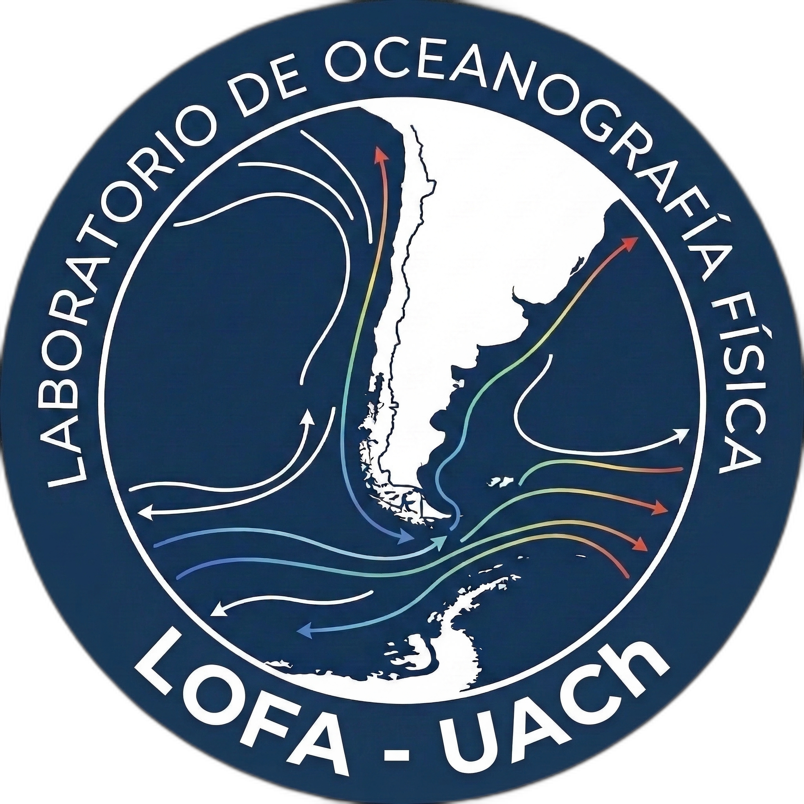

# Dashboard Científico del Anticiclón del Pacífico Sur (APS)
### Laboratorio de Oceanografía Física (LOFA) — Universidad Austral de Chile (UACh)

[](LICENSE)
[](https://laboratorio-oceanografia-fisica-uach.github.io/dashboard-anticiclon-pacifico/)
[](pipeline/)
[](#ciencia-abierta-y-reproducibilidad)

<p align="center">
  
</p>

---

##  Acerca del Proyecto

El **Anticiclón del Pacífico Sur (APS)** es el principal modulador de la variabilidad atmosférica y oceanográfica a lo largo de las costas de Chile y Perú, gobernando el régimen de vientos favorables a la surgencia costera, la radiación solar y la dinámica del Sistema de Corrientes de Humboldt.

Este proyecto es una plataforma web científica de **código abierto y acceso público**, desarrollada por el **Laboratorio de Oceanografía Física (LOFA)** del *Instituto de Ciencias Marinas y Limnológicas* de la **Universidad Austral de Chile (UACh)**. 

### Objetivos:
1. **Monitoreo Continuo e Histórico:** Visualizar la posición (latitud, longitud) e intensidad (PSA en hPa) del núcleo del APS sobre el registro observacional (1940 a la fecha).
2. **Comparación Multimodelo y Pronóstico Operativo:** Contrastar de forma interactiva observaciones de reanálisis (ERA5, NCEP/NCAR), ciclos climatológicos de referencia histórica, respuestas compuestas frente al fenómeno ENOS (Fase El Niño y Fase La Niña), y pronósticos numéricos operativos globales a 7 días (NOAA GFS).
3. **Validación Estadística Inter-Modelo (Skill Scores):** Evaluar cuantitativamente la precisión de los modelos frente a las observaciones de referencia mediante métricas estandarizadas en oceanografía física (RMSE, BIAS, Correlación de Pearson $r$, distancia espacial y el índice de Willmott $d$).
4. **Análisis de Anomalías y Bloqueos:** Identificar desplazamientos o intensificaciones anómalas respecto al ciclo anual climatológico medio, detectando patrones de bloqueo atmosférico y condiciones asociadas a olas de calor marinas (*Marine Heatwaves*).
5. **Ciencia Abierta y Reproducible:** Código 100% auditable y datasets consolidados disponibles para descarga directa en formatos estándar abiertos (CSV y JSON).

---

## 📊 Módulos del Dashboard

- **  Cartografía Sinóptica e Isobaras Dinámicas:**  
  Mosaicos cartográficos de alta definición con proyección de coordenadas, detección del centro bárico (marcador sinóptico "A"), isobaras dinámicas (1012 a 1028 hPa) e hitos costeros de referencia (Lima, Arica, Antofagasta, Valparaíso, Concepción, Puerto Montt, Juan Fernández y Rapa Nui).

- **  Mapa de Anomalías de Presión Superficial:**  
  Campo continuo de desviación barométrica con barra cromática calibrada (-4 a +4 hPa) y consulta puntual interactiva.

- **  Series de Tiempo de Posición y Presión Central (Plotly.js):**  
  Trayectorias multidecadales y recientes con selectores de ventana temporal (30 días, 90 días, 1 año, 5 años e Histórico) y control deslizante interactivo (*rangeslider*).

- **  Selector Multimodelo (Drawer Lateral):**  
  Menú desplegable para activar, desactivar y superponer los 6 modelos y productos científicos disponibles:
  1. *ERA5 Reanálisis (ECMWF - Europa)*: Verdad observacional de referencia histórica y sinóptica (resolución 0.25° con asimilación 4D-Var de satélites y boyas).
  2. *NOAA GFS (Pronóstico Operativo 7 Días)*: Modelo numérico sinóptico global de ecuaciones primitivas (NCEP/NOAA, ciclo 00Z).
  3. *Climatología Histórica LOFA (1940–2024)*: Línea base estacional de 80 años calculada sobre el registro histórico para estimar el ciclo anual medio.
  4. *Fase El Niño (ENOS Cálido)*: Modelo compuesto empírico basado en años Niño históricos (NOAA CPC / OMM); reproduce el debilitamiento barométrico y la migración al norte/oeste.
  5. *Fase La Niña (ENOS Frío)*: Modelo compuesto empírico basado en años Niña históricos; reproduce la intensificación barométrica y la migración hacia latitudes polares.
  6. *NCEP/NCAR Reanalysis (NOAA - EE.UU.)*: Reanálisis atmosférico multidecadal norteamericano para contraste e intercomparación con ERA5.

- **  Matriz de skill-score y Validación Inter-Modelo (Modal):**  
  Ventana emergente con distintivos de calidad, métricas estadísticas (RMSE, BIAS, correlación $r$, error espacial y Willmott $d$) e interpretación pedagógica de errores sistemáticos.

- **  Fundamentos Físicos Oceanográficos (Modales Pedagógicos):**  
  Ventanas explicativas contextuales accesibles mediante botones `ℹ️` en cada tarjeta de indicadores (KPIs), detallando el equilibrio geostrófico, el transporte de Ekman, la surgencia costera y la delimitación oceánica.

- **📥 Descarga de Datos Científicos:**  
  Exportación directa de la serie temporal consolidada multimodelo en CSV (`aps_multimodel_metrics_lofa.csv`).

---

## 🛠️ Arquitectura Técnica

El proyecto opera bajo una arquitectura desacoplada basada en estándares web abiertos y procesamiento científico automatizado:

1. **Pipeline de Datos (`pipeline/`):**
   - Scripts en Python con librerías científicas (`xarray`, `netCDF4`, `numpy`, `scipy`, `pandas`, `cfgrib`).
   - `download_era5.py`: Descarga automatizada de campos diarios de presión desde el *Copernicus Climate Data Store*.
   - `download_gfs_forecast.py`: Extracción directa de pronósticos operativos a 7 días vía el filtro GRIB de NOAA NOMADS.
   - `calculate_aps_metrics.py`: Algoritmo de detección del centro bárico confinado a la ventana puramente oceánica ($18^\circ\text{S} - 45^\circ\text{S}$, $120^\circ\text{W} - 75^\circ\text{W}$) para eliminar artefactos numéricos sobre la Cordillera de los Andes.
2. **Automatización:**
   - Flujos de trabajo de integración y despliegue continuo que actualizan los datos operativos y publican la plataforma.
3. **Frontend (`web/`):**
   - Interfaz web moderna desarrollada en HTML5 semántico, CSS3 modular (tema *Deep Abyss*) y JavaScript Vanilla interactivo con Leaflet.js y Plotly.js, sin dependencias pesadas de frameworks.

---

## 📁 Estructura del Repositorio

```text
dashboard-anticiclon-pacifico/
├── .github/workflows/              # Automatización y despliegue continuo
├── data/
│   ├── raw/                        # Datos brutos NetCDF / GRIB (ignorados por Git)
│   └── processed/                  # Métricas consolidadas en JSON y CSV
├── pipeline/                       # Pipeline científico en Python
│   ├── download_era5.py            # Descarga de reanálisis ERA5 Copernicus
│   ├── download_gfs_forecast.py    # Descarga operativa de pronóstico NOAA GFS
│   ├── calculate_aps_metrics.py    # Detección del APS, cálculo de modelos y validación
│   └── requirements.txt            # Dependencias científicas
├── web/                            # Visualizador web interactivo
│   ├── index.html                  # Estructura principal y modales
│   ├── styles/                     # Sistema de diseño CSS moderno
│   ├── js/                         # Orquestador, mapas, series y selector
│   ├── data/                       # Archivos JSON y CSV para el navegador y descarga
│   └── assets/                     # Recursos gráficos y logo institucional LOFA
├── docs/                           # Documentación oceanográfica y metodológica
│   └── METODOLOGIA.md              # Ecuaciones físicas del APS y dinámica de Ekman
├── CITATION.cff                    # Metadatos estandarizados para citar este software
├── LICENSE                         # Licencia libre GNU AGPLv3
└── README.md
```

---

## 🌐 Acceso Directo a la Plataforma Web

Cualquier usuario, investigador o tomador de decisiones puede consultar el dashboard directamente desde su navegador web **sin necesidad de instalar software, clonar repositorios ni configurar entornos**:

👉 **[Acceder al Observatorio del APS en Vivo](https://laboratorio-oceanografia-fisica-uach.github.io/dashboard-APS/)** 

---

## 💻 Reproducibilidad y Código Fuente

Para investigadores que deseen auditar las rutinas numéricas, verificar la reproducibilidad de los cálculos o procesar sus propios campos de reanálisis, las instrucciones de ejecución técnica están disponibles a continuación:

<details>
<summary><b>🛠️ Desplegar para ver instrucciones de ejecución local del pipeline (Python)</b></summary>

### 1. Clonar el repositorio
```bash
git clone https://github.com/Laboratorio-Oceanografia-Fisica-UACh/dashboard-anticiclon-pacifico.git
cd dashboard-anticiclon-pacifico
```

### 2. Configurar el entorno de Python
```bash
python3 -m venv venv
source venv/bin/activate
pip install -r pipeline/requirements.txt
```

### 3. Ejecutar el pipeline de métricas
```bash
python pipeline/calculate_aps_metrics.py
```

### 4. Servidor de prueba local
```bash
python3 -m http.server 8000 --directory web
```
Abre en tu navegador: `http://localhost:8000`

</details>

---

##  Licencia y Atribución

Este proyecto es software libre y se distribuye bajo la licencia **GNU Affero General Public License v3.0 (AGPLv3)**. Consulta el archivo [LICENSE](LICENSE) para más detalles.

**Atribución Institucional:**  
Laboratorio de Oceanografía Física (LOFA)  
Instituto de Ciencias Marinas y Limnológicas (ICML)  
Facultad de Ciencias — Universidad Austral de Chile  
Valdivia, Chile.
